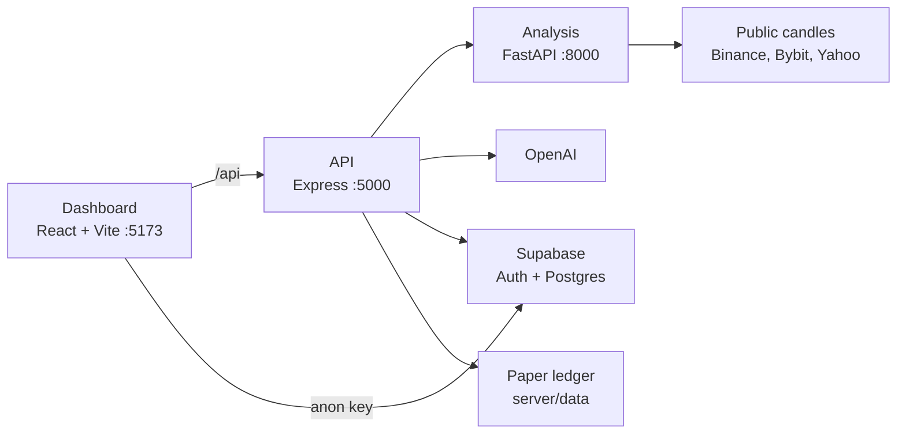

# trading_analysis_agent

Research dashboard for crypto, forex, and metals. It loads public candles, computes indicators, runs paper backtests, keeps a local paper ledger, and can ask a research assistant about the chart. Analysis and paper trading only.

**Research only, not financial advice.**

## Architecture

The browser talks to the Express API. Express orchestrates the research chat and proxies market data to the Python analysis service. Supabase is the system of record for accounts, watchlists, and saved analyses when it is configured. Paper runs stay in a local file.



| Path | Role |
| --- | --- |
| `client/` | Dashboard: chart, backtest page, chat, watchlist, and paper ledger. |
| `server/` | HTTP API, OpenAI tool calling, Supabase access with the service role key. |
| `analysis/` | Candles, indicators, and paper backtests behind one OHLCV shape. |
| `server/supabase/schema.sql` | Tables, Row Level Security, and policies to paste into the Supabase SQL editor. |

Every provider returns the same bar: `timestamp` (UTC), `open`, `high`, `low`, `close`, and `volume`. Volume is null when the source has none. It is never guessed.

## Tech stack

| Layer | Stack |
| --- | --- |
| Dashboard | React 19, Vite 6, Lightweight Charts |
| API | Node 20+, Express 4 |
| Analysis | Python 3.12, FastAPI, NumPy |
| Market data | ccxt (Binance, Bybit fallback), Yahoo Finance via yfinance |
| Assistant | OpenAI tool calling, streamed as server-sent events |
| Accounts | Supabase Auth and Postgres |

## Features

- Crypto pairs such as `BTC/USDT`, forex pairs such as `EURUSD` and `GBPJPY`, and metals `XAUUSD` and `XAGUSD` on one shared path.
- Indicators: RSI(14), MACD(12, 26, 9), EMA 20/50, Bollinger Bands(20, 2), and ATR(14). OBV, MFI, and VWAP appear only when every bar has real volume.
- Chart page with a paper EMA 20/50 crossover: signal on the close, fill at the next open, one position, starting equity 10,000.
- Backtest page for EMA crossover or RSI mean reversion, with an equity curve and a metrics table: total return, win rate, max drawdown, Sharpe ratio, and trade count.
- Asset-class costs on `POST /backtest`: percentage fee and slippage for crypto, a pip spread for forex, and a price-point spread plus slippage for metals.
- Local paper ledger (`POST`, `GET`, and `DELETE /api/paper-runs`). Newest 40 runs.
- Research chat beside the chart. The model may call price and indicator tools and is instructed to cite those numbers.
- Optional sign-in, watchlist, and saved analyses through Supabase. The service role key stays on the server.
- Rule-based signal beside the chart: direction, entry zone, ATR stop, two targets, risk/reward, confidence, and the win rate, drawdown, and trade count of that same rule set. Conflicting indicators return no trade. Price levels are computed in the analysis service.
- Position-size calculator. Forex is reported in lots. Crypto and metals are reported in units.
- Paper trading log in Supabase. A saved signal can be marked hit TP, hit SL, or still open. Run the `paper_trades` section of `server/supabase/schema.sql` before using it.

Every analysis, backtest, and paper-trade screen shows **Research only, not financial advice.** The backtest views also show **Past performance does not predict future results.**

## Setup

Python 3.12 and Node 20 or newer. From the project root:

```powershell
Set-Location analysis
python -m venv .venv
.\.venv\Scripts\python.exe -m pip install -r requirements.txt
if (-not (Test-Path .env)) { Copy-Item .env.example .env }

Set-Location ..\server
npm install
if (-not (Test-Path .env)) { Copy-Item .env.example .env }

Set-Location ..\client
npm install
if (-not (Test-Path .env)) { Copy-Item .env.example .env }
```

`.env` files stay local. The examples contain names and placeholders only.

To use accounts and saved research, paste `server/supabase/schema.sql` into the Supabase SQL editor, then fill the Supabase variables below. Chat needs `OPENAI_API_KEY`. Candles, indicators, and backtests work without either key.

### Run

Open three terminals at the project root. Start analysis, then the API, then the dashboard.

```powershell
# 1. Analysis — port 8000
Set-Location analysis
.\.venv\Scripts\python.exe -m uvicorn main:app --host 127.0.0.1 --port 8000
```

```powershell
# 2. API — port 5000
Set-Location server
npm run dev
```

```powershell
# 3. Dashboard — port 5173
Set-Location client
npm run dev
```

Open [http://127.0.0.1:5173](http://127.0.0.1:5173) or [http://localhost:5173](http://localhost:5173).

### Tests

```powershell
Set-Location analysis
.\.venv\Scripts\python.exe -m unittest discover -s . -p "test_*.py"

Set-Location ..\server
npm test
```

Analysis tests build candles in memory. API route tests stub the analysis service, so they do not call exchanges or OpenAI.

## Environment variables

| Service | Variable | Purpose |
| --- | --- | --- |
| `analysis/.env` | `CACHE_TTL_SECONDS` | How long identical candle requests are reused. Default 60. |
| `analysis/.env` | `CORS_ORIGINS` | Dashboard origins allowed to call FastAPI directly. |
| `analysis/.env` | `CRYPTO_EXCHANGE` | Public ccxt exchange id. Default `binance`. |
| `analysis/.env` | `CRYPTO_FALLBACK_EXCHANGE` | Tried when the primary crypto venue fails. Default `bybit`. |
| `analysis/.env` | `FOREX_SOURCE` | Implemented value: `yfinance`. `twelvedata` is reserved. |
| `analysis/.env` | `METALS_SOURCE` | Implemented value: `yfinance`. `twelvedata` is reserved. |
| `analysis/.env` | `TWELVE_DATA_API_KEY` | Reserved for a future adapter. Not read by the Yahoo path. |
| `server/.env` | `PORT` | Express port. Default 5000. |
| `server/.env` | `ANALYSIS_URL` | Analysis origin. Default `http://127.0.0.1:8000`. |
| `server/.env` | `OPENAI_API_KEY` | Research chat only. Other routes ignore it. |
| `server/.env` | `OPENAI_MODEL` | Optional. Default `gpt-4o-mini`. |
| `server/.env` | `SUPABASE_URL` | Server-side Supabase project URL. |
| `server/.env` | `SUPABASE_SERVICE_ROLE_KEY` | Secret key. Server only. Never put this in a `VITE_` variable. |
| `client/.env` | `VITE_API_URL` | Express origin. Default `http://localhost:5000`. |
| `client/.env` | `VITE_SUPABASE_URL` | Same project URL, used by the browser for Auth. |
| `client/.env` | `VITE_SUPABASE_ANON_KEY` | Publishable anon key only. |

## Screenshots

Save captures at these paths when you add them. The blocks below are placeholders.

### Chart

```text
+----------------------------------------------------------+
|  docs/screenshots/chart.png                              |
|                                                          |
|  BTC/USDT candles, indicator summary, research chat,    |
|  paper EMA panel, and the research disclaimer.           |
+----------------------------------------------------------+
```

### Backtest

```text
+----------------------------------------------------------+
|  docs/screenshots/backtest.png                           |
|                                                          |
|  Strategy form, equity curve, metrics table,             |
|  cost note, and the past-performance sentence.           |
+----------------------------------------------------------+
```

### Narrow layout

```text
+---------------------------+
| docs/screenshots/         |
| backtest-narrow.png       |
|                           |
| Backtest page at 390px.   |
| Form, chart, and table    |
| stacked, disclaimer       |
| still visible.            |
+---------------------------+
```

## API

The dashboard calls Express. These are the routes the UI uses.

| Method | Path | Role |
| --- | --- | --- |
| `GET` | `/api/health` | API process is up. |
| `GET` | `/api/prices` | OHLCV. Query: `asset_type`, `symbol`, `timeframe`, `limit`. |
| `GET` | `/api/indicators` | Indicator series for the same query. |
| `GET` | `/api/backtest` | Paper EMA 20/50 crossover. |
| `POST` | `/api/backtest` | EMA crossover or RSI mean reversion over `period` bars. |
| `POST` | `/api/signal` | Rule-based signal for `asset_type`, `symbol`, and `timeframe`. |
| `POST` | `/api/position-size` | Size from balance, risk percent, entry, and stop. |
| `GET` `POST` `PATCH` `DELETE` | `/api/paper-trades` | Per-user paper signal log. Requires `Authorization: Bearer`. |
| `GET` `POST` `DELETE` | `/api/paper-runs` | Local paper ledger. |
| `POST` | `/api/agent/chat` | Streamed research reply. |
| `GET` `POST` `DELETE` | `/api/watchlist`, `/api/analyses` | Per-user library. Requires `Authorization: Bearer`. |

`asset_type` is `crypto`, `forex`, or `metals`. Timeframes are `1m`, `5m`, `15m`, `30m`, `1h`, `4h`, and `1d`. A bad symbol is 400. A failed upstream source is 502. The API allows 60 requests per minute.

Analysis serves the same market paths without the `/api` prefix, on port 8000. Interactive docs: [http://127.0.0.1:8000/docs](http://127.0.0.1:8000/docs).

## Limitations

- Paper fills and research costs only. There is no order routing, broker key, or withdrawal flow.
- Crypto fees are 10 bps plus 5 bps slippage. Forex uses a 1.5 pip spread (0.01 for JPY pairs, otherwise 0.0001). Metals use a price-point spread (gold 0.40, silver 0.03) plus 2 bps slippage. These are research assumptions, and metal pip sizes differ by broker.
- The chart-page EMA backtest uses a simpler fee: 10 bps crypto, 1 bp forex, 5 bps metals, with no separate slippage model.
- Sharpe uses a zero risk-free rate and bar returns annualized with 365 days for crypto and 252 for forex and metals. A flat equity curve has no Sharpe ratio.
- Forex volume is null, so OBV, MFI, and VWAP are omitted for forex. Metals keep futures volume from Yahoo (`GC=F`, `SI=F`).
- Twelve Data is named in config and is not called.
- Candle responses are cached for about 60 seconds. Public venue limits and outages surface as 502.
- The paper ledger is a file on the API machine, capped at 40 runs. It is not stored in Supabase.
- `agent_conversations` exists in the schema. Chat transcripts are not written there yet.
- Sign-in, watchlists, saved analyses, and the paper trading log stay disabled until the Supabase URL and keys are set and `server/supabase/schema.sql` has been applied. Chat returns 503 until `OPENAI_API_KEY` is set.
- The signal is a fixed rule set on recent candles. It is not a forecast. A no-trade result means the indicators disagree.
- Outputs describe historical bars. They are not a forecast and not a recommendation.

## Disclaimer

Research only, not financial advice.

Past performance does not predict future results.
